# Debugging Playbook

**Last updated:** 2026-10-29

Related: [Incident log](incident-log.md) · [Failure scenarios](failure-scenarios.md) · [Observability handbook](../learning/observability-and-reliability.md) · [Java handbook: thread dumps, GC, profiling](../learning/java-backend.md#thread-dumps) · [Database fundamentals](../learning/database-fundamentals.md)

> This playbook is a **method and a template**. It contains no real incidents. Record real investigations in the [incident log](incident-log.md) and nowhere else. Commands are **[ILLUSTRATIVE]** reference material; adapt to your environment.

## Contents
- [Principles](#principles)
- [The investigation loop](#the-investigation-loop)
- [First five minutes: triage checklist](#first-five-minutes-triage-checklist)
- [Symptom → likely area → first tool](#symptom--likely-area--first-tool)
- [Tool cheat sheet](#tool-cheat-sheet)
- [Incident template](#incident-template)
- [Evidence standards](#evidence-standards)
- [Interview framing](#interview-framing)

## Principles

1. **Mitigate first, diagnose second** (in real incidents): rollback, shed load, disable a flag. For learning exercises, diagnose without mitigating.
2. **Reproduce or instrument.** If you can't reproduce, add telemetry until you can see it.
3. **Hypotheses are falsifiable.** Write "If X is the cause, then Y should be observable"; run the experiment that would *disprove* it.
4. **Change one thing at a time.** Record each change and the result.
5. **Preserve evidence** before restarting (thread dumps, heap dump, logs, metrics screenshots).
6. **Root cause ≠ trigger.** Ask "why" until you reach something you can fix and test (5 whys), and ask why the system didn't catch it.
7. **A fix needs a regression test** (or a monitoring/alert if a test is impossible) and a measurement showing the symptom gone.
8. **Never record a result you didn't observe.**

## The investigation loop

```mermaid
flowchart LR
    S[Symptom + scope] --> E[Expected vs actual]
    E --> D[Gather evidence: logs, metrics, traces, dumps]
    D --> H[Form hypotheses, ranked]
    H --> X[Run cheapest discriminating experiment]
    X -->|refuted| H
    X -->|supported| R[Root cause]
    R --> F[Fix + regression test]
    F --> V[Verify with before/after]
    V --> P[Prevent: alert, runbook, design change]
```



## First five minutes: triage checklist

- **What changed?** deploys, config, flags, traffic, dependencies, data volume, certificates, time.
- **Scope:** all users or some? one endpoint or all? one instance or all? one region?
- **Start time** (from metrics, not from the first complaint).
- **The four golden signals:** latency, traffic, errors, saturation.
- **Dependencies:** DB (connections, slow queries, locks), broker (lag), downstream services.
- **Resource saturation:** CPU, heap/GC, threads, connection pools, disk, file descriptors.
- **Mitigation available?** rollback / restart one instance / scale out / shed load.

## Symptom → likely area → first tool

| Symptom | Likely areas | First tools |
|---|---|---|
| Latency up, CPU low | Waiting: DB, pool, downstream, locks | Thread dump (threads waiting where?), pool metrics, DB slow-query log |
| Latency up, CPU high | Hot loop, GC, serialisation, regex | JFR/profile, GC log, `top -H` |
| Errors 5xx after deploy | Config, schema, contract change | Diff, logs by version, rollback |
| Random 409/lock errors | Concurrency, retries | Logs with versions, DB lock views |
| Duplicates (orders, charges, events) | Retries without idempotency, redelivery, race | Search by idempotency key/event ID; check unique constraints |
| Missing data/event | Dual write, lost message, consumer skipped | Outbox table state, topic offsets, DLT |
| Memory grows, OOM | Leak, unbounded cache/queue | Heap histogram, heap dump, GC "after-GC" trend |
| Stuck workflow | Lost event, failed compensation, no timeout | State+age query, consumer lag, reconciler logs |
| All endpoints time out | Pool exhaustion, thread starvation | Thread dump, Hikari metrics |
| Works locally, fails in env | Config, data volume, DB engine difference (H2 vs real) | Compare config/versions, replay with prod-like data |

## Tool cheat sheet

```bash
# JVM
jcmd                                   # list JVMs
jcmd <pid> Thread.print > td-$(date +%s).txt      # thread dump (take 3, 5-10 s apart)
jcmd <pid> GC.class_histogram | head -30
jcmd <pid> GC.heap_dump /tmp/heap.hprof           # heavy; pauses the app
jcmd <pid> JFR.start duration=60s filename=/tmp/rec.jfr
jstat -gcutil <pid> 1000
top -H -p <pid>                                   # (Linux) hot threads; macOS: use Activity Monitor / sample <pid>

# HTTP
curl -i -H 'X-Request-Id: debug-1' localhost:8080/actuator/health
curl -s -w '\n%{time_total}s\n' localhost:8080/...

# Maven
./mvnw -q test -Dtest=ClassName#method
./mvnw dependency:tree                             # resolve versions (may need network)

# Kafka (when it exists locally)
kafka-consumer-groups.sh --bootstrap-server localhost:9092 --describe --group <group>
kafka-console-consumer.sh --bootstrap-server localhost:9092 --topic <t> --from-beginning --property print.key=true

# SQL (PostgreSQL examples)
EXPLAIN (ANALYZE, BUFFERS) <query>;
SELECT pid, state, wait_event_type, query FROM pg_stat_activity WHERE state <> 'idle';
SELECT * FROM pg_locks WHERE NOT granted;
```
Spring-side switches: `debug=true` (conditions report), `logging.level.org.hibernate.SQL=DEBUG`, `logging.level.org.springframework.transaction.interceptor=TRACE`, `/actuator/threaddump` (local/secured only).

## Incident template

Copy this block into [incident-log.md](incident-log.md) for **every** investigation (real incident or deliberate exercise). Fields in *italics* may be "N/A" but should not be deleted — N/A is information.

```markdown
### INC-NNN — <short title>

| Field | Value |
|---|---|
| **ID** | INC-NNN |
| **Type** | REAL / EXERCISE (link to scenario FS-xx) |
| **Date / duration** | YYYY-MM-DD, time-to-detect / time-to-mitigate / time-to-resolve |
| **Environment** | local / H2 / PostgreSQL x.y / commit hash / app version |
| **Status** | OPEN / MITIGATED / RESOLVED |

**1. Initial symptoms** — what was first noticed, by whom/what, and when.

**2. Expected vs actual behaviour**
- Expected:
- Actual:

**3. Reproduction steps** — exact commands/inputs; reproducibility (always / sometimes 1-in-N / never).

**4. Evidence** (paste real excerpts; no invented data)
- Logs:
- Metrics:
- Traces:
- Thread/heap dumps / EXPLAIN plans:
- Test evidence:

**5. Hypotheses considered** — table: hypothesis | predicted observation | result (supported/refuted) 

**6. Experiments performed** — numbered, chronological, one variable each, with outcome.

**7. Root cause** — mechanism (not just the trigger); why it wasn't caught earlier.

**8. Fix and regression test** — change summary (commit/PR link), test name(s) that fail before and pass after.

**9. Before / after measurements** — same method both times; environment stated; or "not measured".

**10. Prevention and remaining risks** — alerts, runbook, design changes, follow-ups with owners; what could still go wrong.

**11. Interview lessons learned** — the 60-second story (situation → investigation → root cause → fix → lesson) and the concepts exercised (link handbook sections).
```

Short checklist version for a quick note (use when time-boxed): symptom → hypothesis → experiment → result → root cause → fix → test.

## Evidence standards

| Claim | Acceptable evidence |
|---|---|
| "The bug is reproduced" | Command/test + observed output, repeatable |
| "Root cause is X" | An experiment that *predicts* behaviour and confirms it; ideally toggling X on/off flips the symptom |
| "Fixed" | Regression test red→green **and** symptom gone in the original repro |
| "Faster" | Before/after with the same workload, environment, repetitions; report percentiles |
| "No regression" | Full relevant test suite output |

Local-machine and H2 results must say so.

## Interview framing

Behavioural/debugging interviews reward structure: *scope → hypotheses → evidence → mitigation → root cause → prevention*. Use only **real** experience or clearly labelled exercises from this project's log. Practise the 60-second and 5-minute versions aloud and log them in the [mock interview log](../interviews/mock-interview-log.md).
