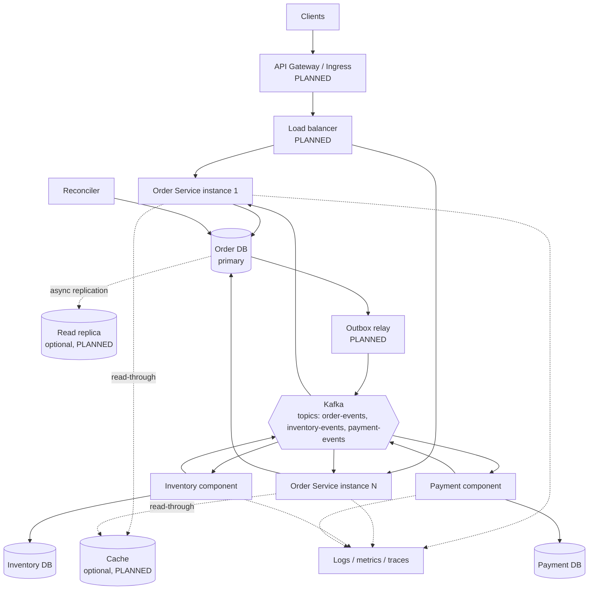
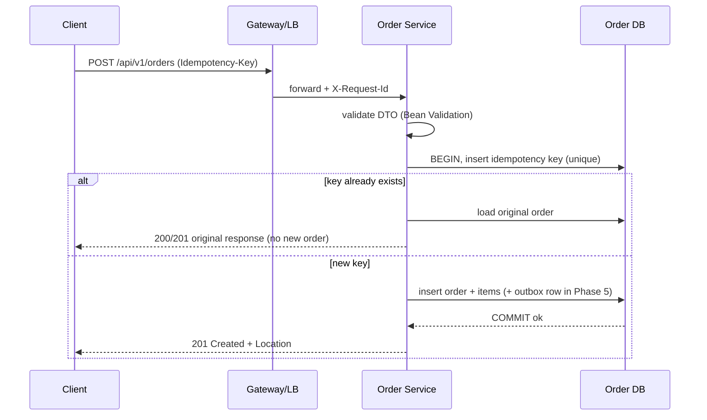
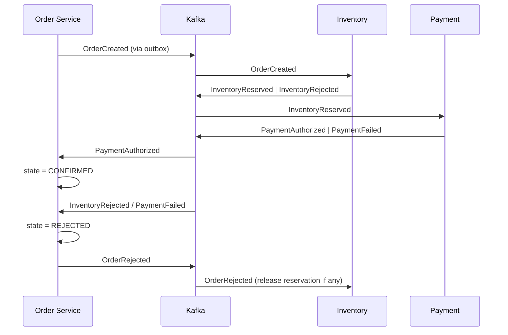

# Architecture

**Last updated:** 2026-10-29

Related: [System overview](system-overview.md) · [Requirements](requirements.md) · [Capacity & scaling](scalability-and-capacity.md) · [ADRs](architecture-decisions.md) · [LLD](../lld/order-service.md) · [Sequence diagrams](../lld/sequence-diagrams.md)

> **Implemented today:** a single Spring Boot 4.1.2 skeleton (web MVC, JPA, validation, actuator, H2). **Everything below is a target design [PLANNED]** unless marked otherwise. Diagrams show the *target*; each one says which parts are not built.

## Contents
- [Component responsibilities](#component-responsibilities)
- [Target architecture diagram](#target-architecture-diagram)
- [Synchronous request flow](#synchronous-request-flow-create-order)
- [Asynchronous event flow](#asynchronous-event-flow-order-confirmation-saga)
- [Data ownership and storage](#data-ownership-and-storage)
- [Edge: API gateway and load balancing](#edge-api-gateway-and-load-balancing)
- [Caching, messaging, partitioning, replication](#caching-messaging-partitioning-replication)
- [Availability, reliability, consistency, fault tolerance](#availability-reliability-consistency-fault-tolerance)
- [Security](#security)
- [Observability](#observability)
- [Deployment](#deployment)
- [Recovery](#recovery)
- [Interview takeaways](#interview-takeaways)

## Component responsibilities

| Component | Responsibility | Owns | Status |
|---|---|---|---|
| API gateway / ingress | TLS termination, routing, authN, rate limiting, request IDs | nothing durable | **[PLANNED / conceptual]** — not in repo; in Kubernetes this is typically an ingress controller or Azure API Management / Application Gateway |
| Load balancer | Spread traffic across instances, health-check, drain | nothing | **[PLANNED / conceptual]** |
| Order Service | Order API, order state machine, order persistence, event publication | `orders`, `order_items`, `idempotency_keys`, `outbox_events` | Skeleton only **[IMPLEMENTED: bare app]**; features **[PLANNED]** |
| Inventory component | Stock reservation/release | `stock`, `reservations`, `processed_events` | **[PLANNED]** simulated |
| Payment component | Authorize/void payment | `payments`, `processed_events` | **[PLANNED]** simulated |
| Message broker (Kafka) | Durable, partitioned, replayable event log | topics | **[PLANNED]** |
| Outbox relay | Move committed outbox rows to the broker reliably | cursor/status on outbox rows | **[PLANNED]** |
| Reconciler | Find and repair stuck orders / drifted state | nothing (reads, issues commands) | **[PLANNED]** |
| Relational DB | System of record per component | data | H2 in-memory on classpath **[IMPLEMENTED]**; production engine **[UNDECIDED]** |
| Cache (Redis or local) | Speed up hot reads | derived data only | **[PLANNED / optional]** |
| Observability stack | Logs, metrics, traces, alerts | telemetry | Actuator on classpath **[IMPLEMENTED]**; rest **[PLANNED]** |

## Target architecture diagram

Notes:
- Entire diagram is **[PLANNED]**. The first three stages of the roadmap use only `Clients → Order Service → DB`.
- "Order Service instance N" means the service is **stateless** so any instance can serve any request; state lives in the DB and broker.
- Each component has its **own database/schema** (data ownership). Even in a modular monolith, enforce this with separate packages and no cross-module table access.

## Synchronous request flow (create order)

**[PLANNED]** — Phase 1 (without idempotency) and Phase 2 (with).

Key points: validation happens before any transaction; the DB commit is the durability point; the response is sent *after* commit. If the response is lost, the client retries with the same key and receives the original result. Details: [sequence diagrams](../lld/sequence-diagrams.md), [database design](../lld/database-design.md).

## Asynchronous event flow (order confirmation saga)

**[PLANNED]** — Phases 4–5. Choreography shown; orchestration alternative in [ADR-0006](architecture-decisions.md#adr-0006--saga-style-choreography-first-orchestration-considered).

Crash analysis for each hop (what if the consumer dies after processing but before committing its offset, etc.) is in [learning/distributed-systems.md](../learning/distributed-systems.md#crash-scenario-table).

## Data ownership and storage

| Data | Owner | Store | Why |
|---|---|---|---|
| Orders, items, status | Order Service | Relational | ACID, constraints, relational queries, small rows. |
| Idempotency keys | Order Service | Same relational DB, same transaction | Atomic with the order insert; needs a unique constraint. |
| Outbox | Order Service | Same relational DB | Atomic with the state change; the point of the pattern. |
| Stock/reservations | Inventory | Own relational schema | Needs row-level locking/conditional updates. |
| Payments | Payment | Own relational schema | Financial records; audit. |
| Events | Kafka | Replicated log | Decoupling, replay, fan-out. Not a system of record. |
| Cached views | Cache | Redis/local | Disposable; must be rebuildable. |

Rules: one writer per datum; others hold **copies/projections** that may lag; reference by ID, never by shared table; events carry enough data to avoid chatty callbacks but are not the source of truth. See [ADR-0003](architecture-decisions.md#adr-0003--relational-database-as-system-of-record).

## Edge: API gateway and load balancing

Concepts (not present in the repo):

- **Load balancer (L4/L7):** distributes requests among stateless instances using round-robin / least-connections; removes unhealthy instances using health checks (`/actuator/health` readiness is the natural target). Needs: graceful shutdown/connection draining; timeouts ≥ backend timeouts consistent end-to-end.
- **API gateway:** a L7 front door adding cross-cutting concerns: auth (JWT validation), rate limiting, request IDs, TLS, routing, sometimes response caching and request transformation.
- **Trade-offs:** a gateway is a single choke point (must be HA), adds latency (≈ ms), and tempts teams to put business logic there (avoid). A service mesh solves service-to-service concerns instead (mTLS, retries) but adds operational weight.
- **Stateless service requirement:** no sticky sessions; no in-memory per-user state that must survive a request.

In a Kubernetes deployment: Ingress/Gateway API → Service (kube-proxy load balances among pods) → Pods with readiness and liveness probes. **[UNVERIFIED]** whether your target is exactly this; conceptually consistent with your Azure/Kubernetes background.

## Caching, messaging, partitioning, replication

Summaries; depth and numbers in [scalability-and-capacity.md](scalability-and-capacity.md).

- **Caching [PLANNED/optional]:** cache-aside for `GET /orders/{id}` of *terminal* orders (immutable once DELIVERED/CANCELLED) is safe and effective; caching non-terminal orders requires invalidation on every transition. Do not cache before measuring a read bottleneck.
- **Messaging [PLANNED]:** Kafka for state-change events; at-least-once delivery + idempotent consumers; key = `orderId` so all events for one order are ordered within a partition.
- **Partitioning:** Kafka topics partitioned by `orderId`; DB partitioning (by date or hash of customer) only when a single node's size/IO is a proven problem.
- **Replication:** Kafka replication factor 3, `min.insync.replicas=2`, producer `acks=all` for durability; DB primary + synchronous/asynchronous replicas trades RPO vs write latency.

## Availability, reliability, consistency, fault tolerance

| Concern | Design stance |
|---|---|
| Single points of failure | Multiple stateless instances; DB with failover; Kafka replicated. In local dev, everything is a SPOF (single JVM, in-memory H2). |
| Consistency | **Strong inside one service's DB transaction.** **Eventual across services**, closed by idempotent consumers, outbox, and reconciliation. Reads from replicas/caches may be stale; the API documents this. |
| CAP framing | Partitions *will* happen; for order creation we prefer **consistency of the order record** over accepting writes that can't be persisted (fail with 503 rather than guess). Downstream steps are AP-style: they proceed eventually. |
| Failure handling | Timeouts on every remote call; bounded retries with backoff+jitter; circuit breakers; bulkheads; dead-letter topics; reconciliation for the leftovers. |
| Overload | Rate limit at the edge; bounded queues/threads; shed load with 429/503 rather than collapse. |
| Idempotency | Mandatory on writes and consumers. |

Principle: *design for the failure between every two steps*. See the crash tables in the distributed-systems handbook.

## Security

**[PLANNED, not scheduled]** — no security dependency exists in the repo.

- **AuthN:** OAuth2/OIDC with JWTs validated at gateway and again in the service (defense in depth). Spring Security would be added deliberately with an ADR.
- **AuthZ:** object-level check on every read/write: `order.customerId == principal.customerId` (BOLA/IDOR is the classic API bug). Never rely on obscure UUIDs.
- **Transport:** TLS at the edge; mTLS or private networking inside.
- **Secrets:** environment/secret store (e.g. Kubernetes Secrets/Key Vault); never in `application.properties` or git.
- **Input:** Bean Validation, size limits, no raw SQL concatenation, no entity binding from request bodies (mass assignment).
- **Data:** minimise PII; logs must not contain tokens or full payment data.
- **Actuator hardening:** only expose needed endpoints; `/actuator/health` yes, `env/heapdump` never publicly. **[UNVERIFIED]** current exposure defaults. Boot's default is to expose only `health` over HTTP; confirm in 4.1.2 docs.
- **H2 console:** the `spring-boot-h2console` dependency is present; keep it disabled/unreachable outside local dev.

## Observability

Three pillars plus alerts; implementation plan in [observability handbook](../learning/observability-and-reliability.md) and Phase 6.

- **Logs:** structured (JSON) with `traceId`, `orderId`, `customerId`(hashed if sensitive).
- **Metrics:** RED (rate, errors, duration) per endpoint; USE for pools/queues; business metrics (orders by state, stuck orders, outbox lag, consumer lag).
- **Traces:** propagate W3C `traceparent` over HTTP and Kafka headers.
- **Alerts:** on SLO burn rate, not on every CPU blip.

## Deployment

**[PLANNED / conceptual]**

- Build a Spring Boot jar/OCI image in CI (note: `./mvnw spring-boot:build-image` needs a Docker daemon, which you don't have; alternatives are Jib, or a CI runner with Docker — decide later).
- Run N replicas on Kubernetes (Azure AKS in your context) with readiness/liveness probes, resource requests/limits, graceful shutdown (`server.shutdown=graceful`).
- Schema migrations run before/with deployment using **expand → migrate → contract** so old and new versions coexist during rolling updates.
- Config via environment/ConfigMap; secrets via secret store.
- Rollout: rolling or canary with automatic rollback on SLO regression.

## Recovery

| Failure | Recovery |
|---|---|
| Instance crash | Orchestrator restarts; other instances serve; in-flight requests retried by clients with idempotency keys. |
| DB primary loss | Failover to replica (RPO depends on sync mode); app reconnects; pool recovers. Test it. |
| Broker outage | Outbox rows accumulate; relay resumes; no data loss; consumers resume from committed offsets. |
| Consumer bug / bad deploy | Fix, then rewind offsets and replay; consumers are idempotent so replays are safe. |
| Stuck orders | Reconciler finds orders non-terminal beyond deadline; re-drives or compensates; alerts if count > threshold. |
| Data corruption | Restore from backup + PITR; rebuild projections from events/DB. Backups must be restore-tested. |

## Interview takeaways

- Draw the *current* box first, then evolve it; justify each added box with a measured/stated need.
- Always state where the **commit point** is and what happens if the process dies on either side of it.
- Say which operations are strongly consistent and which are eventually consistent — per operation, not globally.
