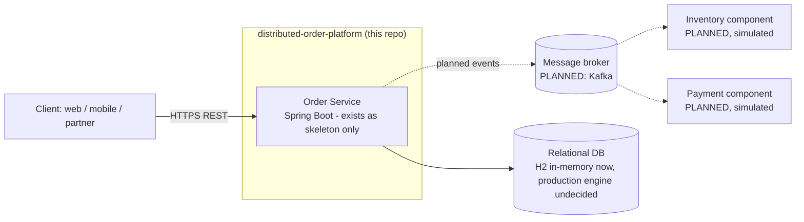
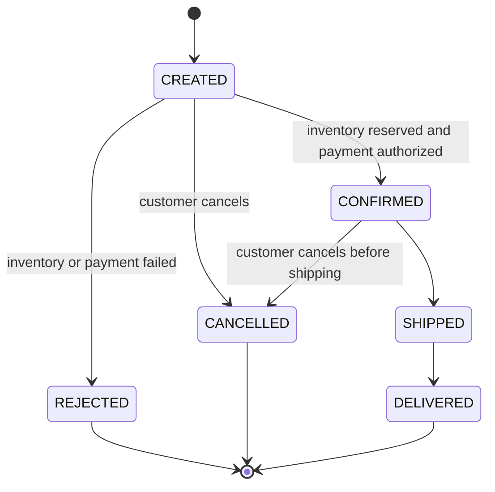

# System Overview

**Last updated:** 2026-10-29

Related: [Requirements](requirements.md) · [Architecture](architecture.md) · [Capacity](scalability-and-capacity.md) · [ADRs](architecture-decisions.md) · [Roadmap](../../LEARNING_ROADMAP.md)

## Contents
- [Status legend](#status-legend)
- [Problem statement](#problem-statement)
- [Business context](#business-context)
- [Scope and non-goals](#scope-and-non-goals)
- [Current state vs target state](#current-state-vs-target-state)
- [System boundary](#system-boundary)
- [Order lifecycle (conceptual)](#order-lifecycle-conceptual)
- [Evolution stages](#evolution-stages)

## Status legend

Labels are defined in [docs/README.md](../README.md#truth-labels-read-this-first): **[IMPLEMENTED]**, **[PLANNED]**, **[ILLUSTRATIVE]**, **[UNVERIFIED]**, **[ASSUMPTION]**.

## Problem statement

**[ASSUMPTION]** The repository does not contain a written problem statement, so the following is a *proposed* domain chosen because it exercises the distributed-systems topics you want to learn.

An e-commerce-style business must accept customer orders reliably, reserve stock, take payment, and track each order through fulfilment. The hard parts, and the learning goals, are:

- **Correctness under concurrency:** two customers cannot buy the last unit; one customer cannot be charged twice.
- **Correctness under failure:** a crash between "order saved" and "event published" must not lose or duplicate business effects.
- **Operability:** when something breaks at 2 a.m., an engineer can find out why from telemetry.

## Business context

**[ASSUMPTION]** Illustrative stakeholders and what they care about:

| Stakeholder | Cares about |
|---|---|
| Customer | Order is accepted quickly, never silently lost, status is accurate. |
| Finance | Never double-charge; every charge maps to an order; reconcilable. |
| Warehouse | No oversell; reservations released on cancel/failure. |
| Support | Can see why an order is stuck and fix it without a developer. |
| Engineers/SRE | Safe deploys, diagnosable failures, bounded blast radius. |

## Scope and non-goals

**In scope (proposed):** order creation, query, cancel; lifecycle state tracking; (later) inventory reservation and payment authorization as simulated collaborators; event-driven coordination; observability; failure injection.

**Non-goals (proposed):** real payment-provider integration, real catalog/pricing engine, UI, multi-currency tax, multi-region active-active, real PII handling. Mentioning them in interviews is good; building them is not the point.

## Current state vs target state

| Capability | Current state (observed 2026-10-29) | Target |
|---|---|---|
| Spring Boot app skeleton | **[IMPLEMENTED]** Boot 4.1.2, Java 21, Maven | — |
| Health endpoint | **[UNVERIFIED]** author reports `/actuator/health` → `{"status":"UP"}`; actuator dependency is declared | Verified in Phase 0 |
| Order REST API | **[PLANNED]** — no controllers exist | Phase 1 |
| Persistence | **[PLANNED]** — JPA and H2 on classpath, no entities | Phase 2 |
| Validation | Dependency present; **no usage yet** | Phase 1 |
| Kafka / events | **[PLANNED]** — no dependency | Phase 4 |
| Outbox, saga, reconciliation | **[PLANNED]** | Phase 5 |
| Metrics/tracing/dashboards | Actuator only; nothing custom | Phase 6 |
| Security (authN/Z) | **[PLANNED]** — no dependency | Not scheduled; see [architecture](architecture.md#security) |
| Gateway, load balancer, cache, multiple services | **[PLANNED / conceptual]** — discussed for interviews only | Not scheduled |

## System boundary

Solid arrows are what the skeleton could do today (a web app with a DB on the classpath); dotted ones are planned.

**Responsibilities and boundary rules**

- The **Order Service owns order data**. No other component writes the orders tables.
- Inventory and payment are *separate responsibilities* even if initially packaged in the same deployable (a modular monolith first; see [ADR-0001](architecture-decisions.md#adr-0001--start-as-a-modular-monolith-not-microservices)).
- Anything crossing a boundary is a **contract** (REST DTO or event schema) and is versioned; internal entities never cross it.

## Order lifecycle (conceptual)

**[PLANNED]** — detailed state machine and legal transitions in [LLD: order-service](../lld/order-service.md#state-machine).

## Evolution stages

| Stage | Shape | Learning purpose | Roadmap |
|---|---|---|---|
| S0 | Skeleton (today) | Tooling and fundamentals | Phase 0 |
| S1 | Single Spring Boot app, REST + RDBMS | Layering, JPA, transactions | Phases 1–2 |
| S2 | Modular monolith, in-process modules for order/inventory/payment | Boundaries before network | Phase 3 |
| S3 | Kafka-connected modules (may remain one repo; possibly separate processes) | Async, idempotency, ordering | Phase 4 |
| S4 | Outbox + saga + reconciliation | Failure correctness | Phase 5 |
| S5 | Observed, load-tested, tuned | Operability | Phases 6–7 |

**Why not microservices immediately?** Network boundaries multiply failure modes before you can recognise them. Learning is faster when you introduce one new failure mode at a time. This is a deliberate learning choice and mirrors common industry advice ("monolith first"), not a claim that the monolith is always right. See [ADR-0001](architecture-decisions.md#adr-0001--start-as-a-modular-monolith-not-microservices).
