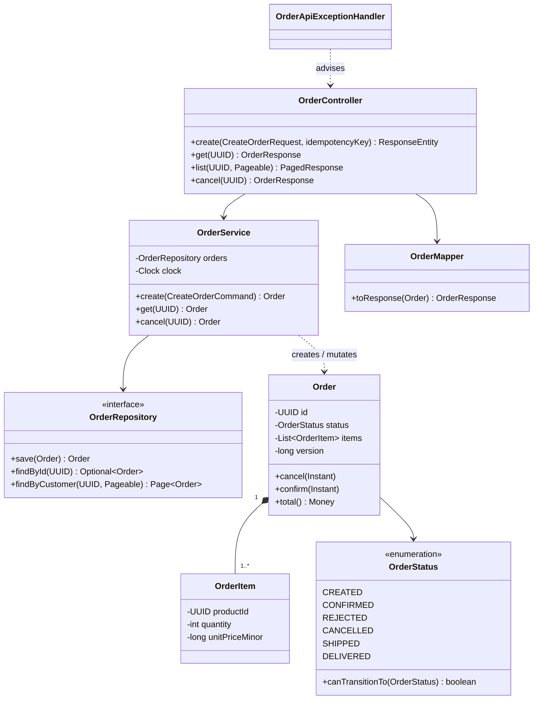

# Class Design

**Last updated:** 2026-10-29

Related: [Order service LLD](order-service.md) · [API contracts](api-contracts.md) · [Database design](database-design.md) · [Sequence diagrams](sequence-diagrams.md) · [Spring handbook](../learning/spring-boot.md) · [LLD interview questions](../interviews/lld-questions.md)

> **All Java in this document is [ILLUSTRATIVE]** and does not exist in the repository (only `DistributedOrderPlatformApplication` exists). It targets Java 21 / Spring Boot 4.1.2 / Hibernate 7 conventions but has **not been compiled**. Verify imports and APIs when you implement.

## Contents
- [Class diagram](#class-diagram)
- [Responsibilities and relationships](#responsibilities-and-relationships)
- [Illustrative code](#illustrative-code)
- [Entity vs domain model](#entity-vs-domain-model)
- [SOLID applied to this design](#solid-applied-to-this-design)
- [Design patterns: when justified, when not](#design-patterns-when-justified-when-not)
- [Equality, immutability, and JPA](#equality-immutability-and-jpa)
- [Test design](#test-design)

## Class diagram



## Responsibilities and relationships

- `Order` is the **aggregate root**: all changes to items/status go through it so invariants hold. `OrderItem` has no repository of its own.
- `OrderService` is a **stateless** application service (singleton bean). It must not hold per-request mutable fields (thread safety).
- `OrderRepository` is a **port** (interface in the domain/application side); the Spring Data JPA interface is the adapter. This keeps `OrderService` unit-testable with an in-memory fake.
- `OrderMapper` isolates DTO mapping (hand-written first; MapStruct only if it earns its keep).

## Illustrative code

### Domain: `Order` with an enforced state machine

```java
// [ILLUSTRATIVE] - does not exist in the repository
public enum OrderStatus {
    CREATED, CONFIRMED, REJECTED, CANCELLED, SHIPPED, DELIVERED;

    private static final Map<OrderStatus, Set<OrderStatus>> ALLOWED = Map.of(
        CREATED,   EnumSet.of(CONFIRMED, REJECTED, CANCELLED),
        CONFIRMED, EnumSet.of(CANCELLED, SHIPPED),
        SHIPPED,   EnumSet.of(DELIVERED),
        REJECTED,  EnumSet.noneOf(OrderStatus.class),
        CANCELLED, EnumSet.noneOf(OrderStatus.class),
        DELIVERED, EnumSet.noneOf(OrderStatus.class));

    public boolean canTransitionTo(OrderStatus next) { return ALLOWED.get(this).contains(next); }
}

public class IllegalStateTransitionException extends RuntimeException {
    public IllegalStateTransitionException(UUID id, OrderStatus from, OrderStatus to) {
        super("Order %s cannot move from %s to %s".formatted(id, from, to));
    }
}

public class Order {
    private final UUID id;
    private final UUID customerId;
    private OrderStatus status = OrderStatus.CREATED;
    private final List<OrderItem> items;
    private Instant updatedAt;

    public Order(UUID id, UUID customerId, List<OrderItem> items, Instant now) {
        if (items == null || items.isEmpty()) throw new IllegalArgumentException("order needs items");
        this.id = Objects.requireNonNull(id);
        this.customerId = Objects.requireNonNull(customerId);
        this.items = List.copyOf(items);          // defensive immutable copy
        this.updatedAt = now;
    }

    public UUID getId() { return id; }
    public void cancel(Instant now) { transitionTo(OrderStatus.CANCELLED, now); }
    public void confirm(Instant now) { transitionTo(OrderStatus.CONFIRMED, now); }

    private void transitionTo(OrderStatus next, Instant now) {
        if (!status.canTransitionTo(next)) throw new IllegalStateTransitionException(id, status, next);
        this.status = next;
        this.updatedAt = now;
    }

    public long totalMinor() {
        return items.stream().mapToLong(i -> Math.multiplyExact(i.unitPriceMinor(), i.quantity())).sum();
    }
}

public record OrderItem(UUID productId, int quantity, long unitPriceMinor) {
    public OrderItem {
        if (quantity <= 0 || unitPriceMinor <= 0) throw new IllegalArgumentException("invalid item");
    }
}
```

Points: no setters; invalid states unrepresentable; `Math.multiplyExact` fails loudly on overflow; the transition table is data, easily unit-tested and extended.

### Application service: transaction boundary and collaborators

```java
// [ILLUSTRATIVE]
@Service
public class OrderService {
    private final OrderRepository orders;
    private final Clock clock;

    public OrderService(OrderRepository orders, Clock clock) {   // constructor injection
        this.orders = orders;
        this.clock = clock;
    }

    @Transactional
    public Order create(CreateOrderCommand cmd) {
        Order order = new Order(UUID.randomUUID(), cmd.customerId(), cmd.items(), clock.instant());
        return orders.save(order);
    }

    @Transactional(readOnly = true)
    public Order get(UUID id) {
        return orders.findById(id).orElseThrow(() -> new OrderNotFoundException(id));
    }

    @Transactional
    public Order cancel(UUID id) {
        Order order = get(id);        // same-class call joins this transaction; no proxy needed
        order.cancel(clock.instant());
        return orders.save(order);
    }
}
```

### Controller: thin

```java
// [ILLUSTRATIVE]
@RestController
@RequestMapping("/api/v1/orders")
class OrderController {
    private final OrderService service;
    private final OrderMapper mapper;

    OrderController(OrderService service, OrderMapper mapper) { this.service = service; this.mapper = mapper; }

    @PostMapping
    ResponseEntity<OrderResponse> create(@Valid @RequestBody CreateOrderRequest req) {
        Order created = service.create(mapper.toCommand(req));
        return ResponseEntity.created(URI.create("/api/v1/orders/" + created.getId()))
                             .body(mapper.toResponse(created));
    }
}
```

### Error handling

```java
// [ILLUSTRATIVE]
@RestControllerAdvice
class OrderApiExceptionHandler {
    @ExceptionHandler(OrderNotFoundException.class)
    ProblemDetail notFound(OrderNotFoundException e) {
        var pd = ProblemDetail.forStatusAndDetail(HttpStatus.NOT_FOUND, e.getMessage());
        pd.setProperty("code", "ORDER_NOT_FOUND");
        return pd;
    }

    @ExceptionHandler(IllegalStateTransitionException.class)
    ProblemDetail conflict(IllegalStateTransitionException e) {
        var pd = ProblemDetail.forStatusAndDetail(HttpStatus.CONFLICT, e.getMessage());
        pd.setProperty("code", "ILLEGAL_STATE_TRANSITION");
        return pd;
    }
}
```

### Persistence mapping (if entity = domain class)

```java
// [ILLUSTRATIVE] annotated variant
@Entity @Table(name = "orders")
class OrderEntity {
    @Id private UUID id;
    @Enumerated(EnumType.STRING) @Column(nullable = false) private OrderStatus status;
    @Version private long version;
    @OneToMany(cascade = CascadeType.ALL, orphanRemoval = true, fetch = FetchType.LAZY)
    @JoinColumn(name = "order_id")
    private List<OrderItemEntity> items = new ArrayList<>();
    protected OrderEntity() {}          // JPA requires a no-arg constructor (protected is enough)
}
```

## Entity vs domain model

| Option | Pros | Cons | Recommendation |
|---|---|---|---|
| **A. JPA entity is the domain class** (annotated) | Less code, no mapping | Framework constraints leak (no-arg ctor, mutability, lazy proxies); domain tests tempted to need Spring | Fine for Phases 1–2 if invariants stay in methods and tests remain plain JUnit |
| **B. Separate domain + JPA entity** (mapping layer) | Pure domain, swap persistence | More classes/mapping bugs | Adopt when the domain gets rich or the module is extracted |

Whatever the choice: **never use the entity as the HTTP DTO** (mass assignment, lazy-loading serialization errors, accidental contract changes).

## SOLID applied to this design

| Principle | Where it shows up | Violation to avoid |
|---|---|---|
| **S**ingle Responsibility | Controller (HTTP), service (use case), `Order` (rules), repository (persistence) | A 600-line `OrderService` that validates, prices, persists, emails, and publishes events |
| **O**pen/Closed | Pricing/discount as `PricingPolicy` implementations; new event types as new handlers | Growing `switch (type)` in many places |
| **L**iskov | Any `OrderRepository` (JPA, in-memory fake) must honour the same contract (e.g. `save` returns persisted instance; `findById` empty not null) | A fake that returns null |
| **I**nterface Segregation | Small ports: `OrderRepository`, `EventPublisher`, `Clock` | A `GodRepository` with 40 methods |
| **D**ependency Inversion | Service depends on `OrderRepository` interface and `Clock`, injected by Spring | `new JpaOrderRepository()` or `LocalDate.now()` in logic |

## Design patterns: when justified, when not

| Pattern | Use here? | Justification / caution |
|---|---|---|
| Repository | Yes | Persistence abstraction; testing seam |
| State (transition table) | Yes, via enum table now; promote to State objects only if behaviour per state grows | Enum + table is simpler; GoF State classes are overkill for ≤ 6 states with no per-state behaviour |
| Strategy | Later: pricing, retry policy, partition-key selection | Only when ≥ 2 real variants exist |
| Factory / static factory | `Order.create(...)` if construction gets complicated | Avoid a factory class for a 3-arg constructor |
| Builder | Test data builders (`anOrder().withStatus(...)`) | Helpful in tests; records need less |
| Observer / domain events | `OrderCancelled` events → outbox | In-process first; becomes integration event later |
| Outbox, Inbox, Saga | Yes in Phases 4–5 | See [distributed systems](../learning/distributed-systems.md) |
| Singleton | Spring beans are singletons by default | Don't write your own singletons |
| Adapter / Anti-corruption layer | When integrating inventory/payment contracts | Prevents foreign models leaking in |
| Decorator | Resilience wrappers (retry, circuit breaker) around a client | Keep business code free of retry loops |
| Template Method / inheritance | Rarely | Prefer composition |

Rule: name the **force** that justifies a pattern (a second implementation, a testing seam, a changing requirement). If you can't, don't add it.

## Equality, immutability, and JPA

- Records give value equality for DTOs and value objects (`OrderItem`, `Money`).
- JPA entities: `equals/hashCode` is subtle — don't use generated-ID-based equality if the ID is null before persist; with application-assigned UUIDs, equality on `id` is safe. Don't include lazy collections in `toString/equals/hashCode`. See [Java handbook](../learning/java-backend.md#equality-and-hashing).
- Expose collections as unmodifiable views/copies.

## Test design

| Class | Test | Technique |
|---|---|---|
| `OrderStatus` | Every (from, to) pair against an expected matrix | Parameterised test over all 36 pairs |
| `Order` | Cancel from each state; total with overflow; empty items | Plain JUnit 5 + AssertJ |
| `OrderService` | Create/cancel with fake repo, fixed `Clock` | `Clock.fixed(...)`, in-memory fake (preferred over heavy mocking) |
| `OrderController` | 201/400/404/409 and JSON shape | `@WebMvcTest` + mocked `OrderService` |
| Persistence | Constraints, `@Version`, query counts | `@DataJpaTest` |
| Concurrency | Two threads cancel/confirm | `ExecutorService` + `CountDownLatch`, assert exactly one winner |

See [testing handbook](../learning/testing-and-quality.md).
