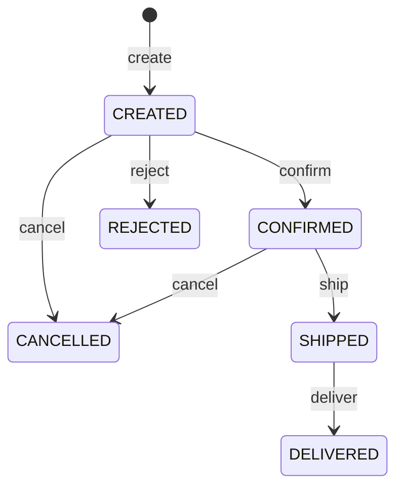

# Order Service — Low-Level Design

**Last updated:** 2026-10-29

Related: [API contracts](api-contracts.md) · [Database design](database-design.md) · [Class design](class-design.md) · [Sequence diagrams](sequence-diagrams.md) · [HLD architecture](../hld/architecture.md) · [Requirements](../hld/requirements.md)

> **Status of this document: design [PLANNED].** The repository currently contains only [`DistributedOrderPlatformApplication`](../../src/main/java/com/ashish/distributed_order_platform/DistributedOrderPlatformApplication.java). Package names, classes, and code below do not exist yet. Code blocks are **[ILLUSTRATIVE]**.

## Contents
- [Scope](#scope)
- [Package layout](#package-layout)
- [Layer responsibilities](#layer-responsibilities)
- [State machine](#state-machine)
- [Transaction boundaries](#transaction-boundaries)
- [Validation strategy](#validation-strategy)
- [Error handling](#error-handling)
- [Dependency injection](#dependency-injection)
- [Concurrency control](#concurrency-control)
- [Unit vs integration test boundaries](#unit-vs-integration-test-boundaries)
- [Implementation checklist](#implementation-checklist)

## Scope

Order Service covers FR-1…FR-6 from [requirements](../hld/requirements.md) in Phases 1–2; event publication (FR-7) and saga participation (FR-8) come in Phases 4–5. Design principle: **business rules live in the domain, orchestration in the application layer, I/O at the edges.**

## Package layout

Base package (real): `com.ashish.distributed_order_platform`. Package-by-feature, with layers inside each feature, so modules can later be extracted ([ADR-0001](../hld/architecture-decisions.md#adr-0001--start-as-a-modular-monolith-not-microservices)).

```text
com.ashish.distributed_order_platform                 [IMPLEMENTED: only the Application class]
├── DistributedOrderPlatformApplication               [IMPLEMENTED]
├── order                                             [PLANNED]
│   ├── api            OrderController, dto/*, OrderApiExceptionHandler
│   ├── application    OrderService (use cases), OrderMapper
│   ├── domain         Order, OrderItem, OrderStatus, Money, domain exceptions, OrderRepository (port)
│   └── infrastructure JpaOrderRepository adapter / Spring Data interface, entity mapping if separated
├── inventory                                         [PLANNED, Phase 4]
├── payment                                           [PLANNED, Phase 4]
├── messaging                                         [PLANNED, Phase 4–5]  outbox, publisher, event schemas
└── shared                                            [PLANNED]  error model, correlation-id filter, time/ID providers
```

Rule: dependencies point **inward** — `api → application → domain`; `infrastructure → domain`. The domain imports no Spring web classes. (Whether the domain may use JPA annotations directly is a pragmatic trade-off: see [class design](class-design.md#entity-vs-domain-model).) Verify with an ArchUnit test later (adds a test dependency; ADR first).

## Layer responsibilities

| Layer | Class (planned) | Responsibility | Must **not** |
|---|---|---|---|
| API | `OrderController` | Map HTTP ↔ DTO; trigger validation (`@Valid`); call one application method; pick status code. | Contain business rules, open transactions, touch repositories. |
| API | `OrderApiExceptionHandler` (`@RestControllerAdvice`) | Convert exceptions to one error format. | Swallow errors; leak stack traces. |
| Application | `OrderService` | Use cases: `create`, `get`, `list`, `cancel`; define transaction boundary; coordinate repository + domain + (later) outbox. | Know about HTTP; hold request state. |
| Domain | `Order` (aggregate root) | Enforce invariants and legal state transitions; compute totals. | Know about persistence frameworks' sessions, HTTP, JSON. |
| Domain | `OrderStatus` | State names and transition table. | — |
| Domain | `OrderRepository` | Port: save, findById, query by customer. | Expose JPA types to callers. |
| Infra | Spring Data repo | SQL/JPA details; custom queries with indexes in mind. | Contain business logic. |

## State machine

**[PLANNED]** — transitions are enforced inside `Order` (domain), never in the controller. Introduced per phase.

| From \ Event | `confirm` | `reject` | `cancel` | `ship` | `deliver` |
|---|---|---|---|---|---|
| `CREATED` | → `CONFIRMED` (Ph 4+) | → `REJECTED` (Ph 4+) | → `CANCELLED` | ✗ | ✗ |
| `CONFIRMED` | ✗ (idempotent no-op if already) | ✗ | → `CANCELLED` (+ compensate) | → `SHIPPED` | ✗ |
| `SHIPPED` | ✗ | ✗ | ✗ | ✗ | → `DELIVERED` |
| `REJECTED`, `CANCELLED`, `DELIVERED` | terminal — all ✗ | | | | |



Design rules:
- **Illegal transition** → domain exception → HTTP `409 Conflict`.
- **Duplicate event for an already-applied transition** (e.g. `confirm` on `CONFIRMED`) → treat as a no-op for idempotent consumers; this distinction matters in Phase 4. Decide and document per transition.
- **Phase 1–2 subset:** `CREATED` and `CANCELLED` only (the others need the saga).
- A `status_history` / audit record per transition is a "could" (FR-10).

## Transaction boundaries

**[PLANNED]** — Spring `@Transactional` on **application service methods**, not on controllers or repositories.

| Use case | Boundary | Contents | Not in the transaction |
|---|---|---|---|
| `create` | One DB transaction | idempotency-key insert, order + items insert, (Ph 5) outbox insert | Request validation (before), HTTP response, Kafka publish |
| `get` / `list` | Read-only transaction (`readOnly = true`) | queries; map to DTO **inside** the boundary if lazy relations are used | — |
| `cancel` | One DB transaction | load with version, transition, save, (Ph 5) outbox insert | Notifying other systems directly |
| Consumer handling an event | One DB transaction | inbox/dedupe insert + state change + outbox | Offset commit (after the transaction; see crash table) |

Rules to remember:
- Never call a remote service or broker inside a DB transaction (holds connections/locks; can't be rolled back).
- `@Transactional` works through a proxy: calls from within the same class bypass it (**self-invocation**), and by default only unchecked exceptions roll back. See [Spring handbook](../learning/spring-boot.md#transactional-proxies-and-pitfalls).
- Keep transactions short; no user-facing latency inside.

## Validation strategy

Three levels, each catching a different class of error:

1. **Syntactic (API layer, Bean Validation):** non-null, sizes, ranges, formats on the request DTO. → `400` with field errors.
2. **Semantic/business (domain):** `quantity > 0`, total within limits, state transitions legal. → `422` or `409` (choose and document).
3. **Database (constraints):** `NOT NULL`, `CHECK`, `UNIQUE`, FKs — last line of defense against races and bugs. → mapped to `409`/`500` depending on cause.

Never trust one level alone; the DB level is the only one that is race-free.

## Error handling

- One error format: RFC 9457 `application/problem+json` via Spring's `ProblemDetail` ([API contracts](api-contracts.md#error-model)).
- Domain exceptions are unchecked, specific, and carry machine-readable codes (`ORDER_NOT_FOUND`, `ILLEGAL_STATE_TRANSITION`, `CONCURRENT_MODIFICATION`).
- Mapping table (planned): validation → 400; not found → 404; illegal transition / optimistic-lock conflict / idempotency-key payload mismatch → 409 (or 422 for mismatch); unexpected → 500 with a correlation ID and **no internals**.
- Log once, at the boundary, with the correlation ID; do not log-and-rethrow at every layer.

## Dependency injection

- **Constructor injection** everywhere; final fields; no field `@Autowired`. Makes dependencies explicit and unit tests trivial (`new OrderService(fakeRepo, clock)`).
- Inject abstractions for non-determinism: `Clock`, an `IdGenerator`/`Supplier<UUID>`. Avoids `Instant.now()` and `UUID.randomUUID()` buried in logic that tests can't control.
- Bean wiring in a small `@Configuration` only where the framework can't discover (e.g. `Clock`).
- More: [Spring handbook](../learning/spring-boot.md#dependency-injection-and-the-ioc-container).

## Concurrency control

| Scenario | Mechanism | Failure behavior |
|---|---|---|
| Two clients modify same order (cancel vs confirm) | `@Version` optimistic lock | Loser gets 409 / consumer retries with fresh state |
| Same create request retried | Unique `(customer_id, idempotency_key)` | Second request returns the first result |
| Same event redelivered | Inbox unique `(consumer, event_id)` | Skipped; ack |
| Stock decrement (Inventory) | Conditional `UPDATE … WHERE available >= qty` | Zero rows updated → reject |

Details and DDL: [database design](database-design.md).

## Unit vs integration test boundaries

| Test type | What it covers | Spring? | DB? | Speed |
|---|---|---|---|---|
| Domain unit | `Order` invariants, state machine, money math | No | No | ms |
| Service unit | `OrderService` with fake/mock repo and fixed `Clock` | No | No | ms |
| Web slice | Controller mappings, validation, error JSON (`@WebMvcTest` + mocked service) | Partial | No | ~1 s |
| Persistence slice | Queries, constraints, `@Version`, N+1 guard (`@DataJpaTest`) | Partial | Yes (H2 now; real DB later) | ~1–3 s |
| Integration | Controller→service→DB with real wiring (`@SpringBootTest`), concurrency tests | Full | Yes | seconds |
| Contract | Event/API schema compatibility | Varies | No | fast |
| End-to-end | Running app, real HTTP, (later) broker | Full | Yes | slow |

Boot 4 reorganised test-slice packages and annotations (e.g. `@WebMvcTest`, `@MockitoBean`); verify imports against the 4.1.2 reference. Test strategy overview: [testing handbook](../learning/testing-and-quality.md).

**Currently implemented tests:** only the empty `contextLoads` test ([source](../../src/test/java/com/ashish/distributed_order_platform/DistributedOrderPlatformApplicationTests.java)). Whether it passes has not been verified on this machine.

## Implementation checklist

Tick only when the code **and** tests exist; link to them.

- [ ] `Order`, `OrderItem`, `OrderStatus`, `Money` domain with unit tests
- [ ] `OrderRepository` + in-memory implementation (Phase 1)
- [ ] DTOs + validation + controller (`@WebMvcTest`)
- [ ] `@RestControllerAdvice` error model
- [ ] JPA mapping + migrations (Phase 2)
- [ ] `@Version` + 409 mapping + concurrency test
- [ ] Idempotency-Key + duplicate test
- [ ] Outbox write (Phase 5)
