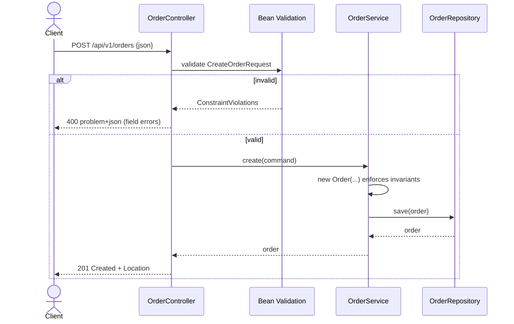
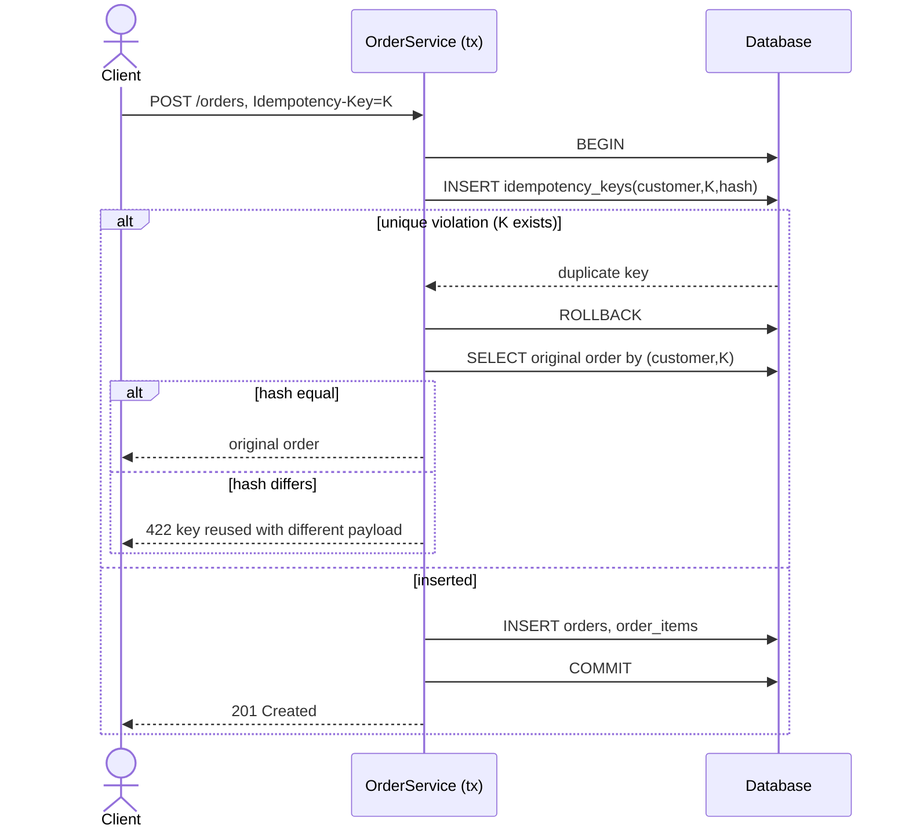
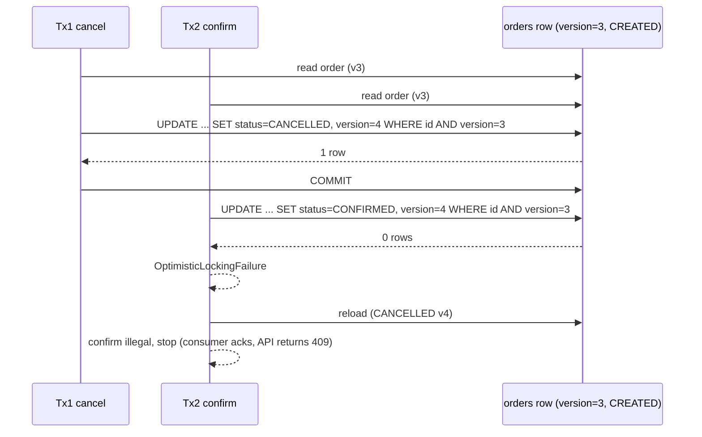
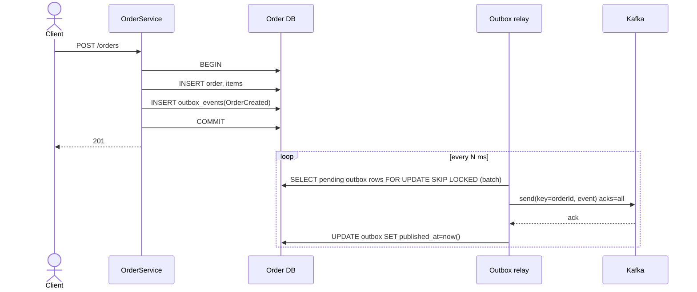
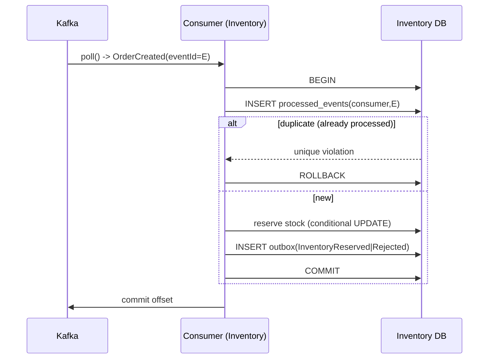
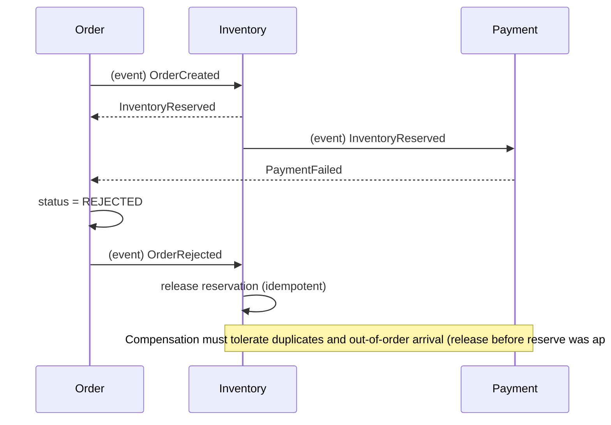
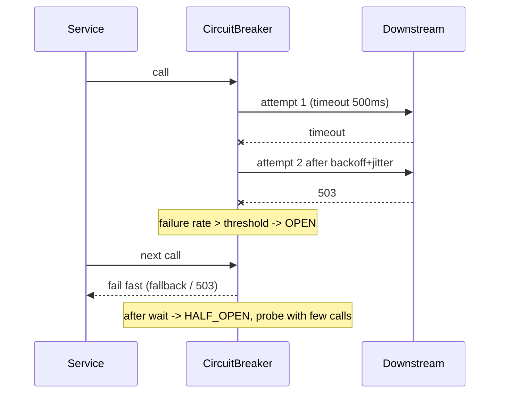
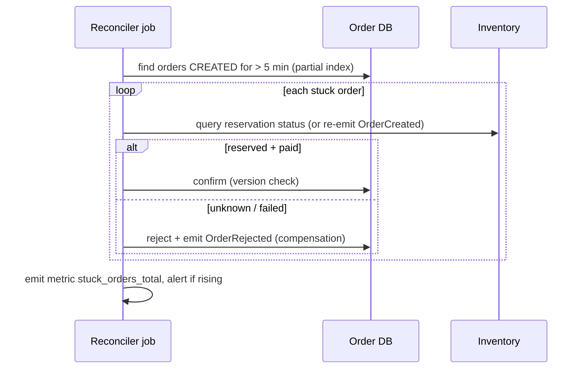

# Sequence Diagrams

**Last updated:** 2026-10-29

Related: [Order service LLD](order-service.md) · [HLD architecture](../hld/architecture.md) · [Distributed systems handbook](../learning/distributed-systems.md) · [Failure scenarios](../debugging/failure-scenarios.md)

> **All flows are [PLANNED].** None is implemented. Each flow notes the phase in which it would be built and the crash points to test. Mermaid blocks are syntax-checked only by rendering (VS Code Markdown preview with a Mermaid extension, or GitHub).

## Contents
1. [Create order (Phase 1: no persistence guarantees)](#1-create-order-phase-1)
2. [Create order with idempotency (Phase 2)](#2-create-order-with-idempotency-phase-2)
3. [Concurrent cancel vs confirm (Phase 2)](#3-concurrent-cancel-vs-confirm-phase-2)
4. [Create order with outbox and relay (Phase 5)](#4-create-order-with-outbox-and-relay-phase-5)
5. [Idempotent consumer (Phase 4)](#5-idempotent-consumer-phase-4)
6. [Saga with compensation (Phase 5)](#6-saga-with-compensation-phase-5)
7. [Retry with circuit breaker (Phase 5)](#7-retry-with-circuit-breaker-phase-5)
8. [Reconciliation of a stuck order (Phase 5)](#8-reconciliation-of-a-stuck-order-phase-5)

## 1. Create order (Phase 1)

## 2. Create order with idempotency (Phase 2)

**Crash points to test:** (a) crash before COMMIT → nothing persisted → client retry creates it once; (b) crash after COMMIT before response → client retry gets original via key; (c) two simultaneous requests with the same key → the second blocks on the unique index, then sees the duplicate.

## 3. Concurrent cancel vs confirm (Phase 2)

## 4. Create order with outbox and relay (Phase 5)

**Crash analysis**

| Crash point | State left behind | Outcome |
|---|---|---|
| Before COMMIT | No order, no outbox row | Client retries (same key); consistent |
| After COMMIT, before response | Order + pending outbox row | Relay publishes anyway; client retry returns original |
| Relay after `send`, before marking published | Event in Kafka, row still pending | Relay republishes → **duplicate event**; consumers dedupe by `eventId` |
| Relay before `send` | Row pending | Published on the next poll |
| Kafka down | Rows accumulate | Relay backs off; alert on outbox age; no loss |

## 5. Idempotent consumer (Phase 4)

**Crash analysis:** crash after DB COMMIT but before the offset commit → Kafka redelivers E → insert into `processed_events` fails → skipped → offset committed. Crash before COMMIT → nothing happened → redelivery processes normally. This is "at-least-once delivery + idempotent effect = effectively-once".

## 6. Saga with compensation (Phase 5)

Hard cases to design for: compensation arrives before the original action (record a "tombstone" so a late reserve is ignored); a timeout with no reply (reconciler); payment authorized but order cancelled concurrently (void the authorization).

## 7. Retry with circuit breaker (Phase 5)

Retries must be bounded, only for idempotent operations, with a total deadline, and budgeted (e.g. ≤ 10% extra traffic) or they cause retry storms ([FS-05](../debugging/failure-scenarios.md)).

## 8. Reconciliation of a stuck order (Phase 5)

The reconciler is the safety net that makes "eventually consistent" a bounded promise rather than a hope.
